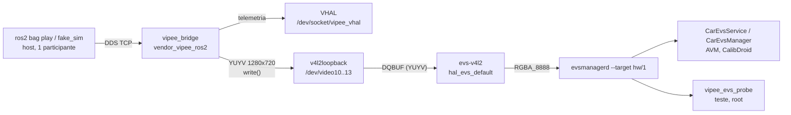
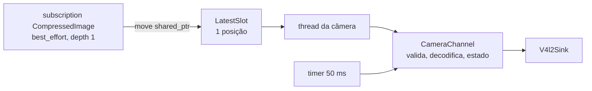

# cam-evs-slice Design

**Spec**: `.specs/features/cam-evs-slice/spec.md`
**Status**: Approved

---

## Architecture Overview

O processo ROS da ponte (AD-012) assina os 4 `/compressed`, decodifica o JPEG para YUYV e escreve cada quadro num dispositivo `v4l2loopback` (`/dev/video10..13`). A HAL `evs-v4l2` do AOSP lê esses dispositivos como câmeras V4L2 comuns e o `evsmanagerd` as entrega ao `CarEvsService`/`CarEvsManager`. Não há IPC de vídeo próprio: o `v4l2loopback` é o IPC. A HAL acima dele é `vipee-evs-v4l2`, fork mínimo da `evs-v4l2` do `aosp_rpi5_car` com 4 patches de robustez (AD-016, T3).



Dentro do processo ROS, por câmera:



A subscription só troca o ponteiro no slot e acorda a thread da câmera; o executor do ROS nunca decodifica. Assim a telemetria não espera pelo vídeo (CAM-05, CAM-08).

---

## Code Reuse Analysis

### Existing Components to Leverage

| Component | Location | How to Use |
| --------- | -------- | ---------- |
| Mapa por veículo e validação | `core/include/vipee/vehicle_map.h`, `core/src/vehicle_map.cpp` | Ganha a seção `cameras`; `map_version` sobe para 2 |
| Leitura do mapa dos parâmetros ROS | `ros/vipee_bridge/src/bridge_node.cpp` (`mapFromOverrides`) | Estende para `cameras.<pos>.*` |
| Logger por transição | `core/include/vipee/bridge.h` (`Logger`), `ros/vipee_bridge/src/main.cpp` (`PlatformLogger`) | Mesmo padrão: um log por transição, tag `vipee_bridge` |
| Recusa de mapa sem derrubar o processo | `main.cpp` (`initRclcpp`, CTS-23) | Mapa de câmeras inválido segue o mesmo caminho |
| Build cruzado e push | `tools/jazzy/build-android.sh`, `build-bridge.sh`, `install-vendor.sh` | `sensor_msgs` e libjpeg-turbo entram no build; instalação com cópia `*.stock` e `remove`, como o VHAL |
| Domínio SELinux e sync | `tools/jazzy/sepolicy/`, `sepolicy-sync.sh` | Uma regra nova (`video_device`) |
| Build de módulos AOSP | `~/aosp-scripts/vm_m.sh`, `tools/emu/vhal-sync.sh` | `evs-v4l2` (sem mudar fonte do AOSP) e o probe |
| Simulador falso e e2e | `tools/emu/fake_sim.py`, `test-e2e.sh` | `fake_sim` passa a publicar as 4 câmeras; o e2e roda com elas ligadas |
| HAL `evs-v4l2` | `~/aosp/packages/services/Car/cpp/evs/v4l2_hal/aidl` | Usada sem alteração; configuração por XML |
| Spike v4l2loopback | `~/ros2_android_ws/spike_v4l2/v4l2_spike.cpp` | Referência do escritor (formato, `write()`) |

### Integration Points

| System | Integration Method |
| ------ | ------------------ |
| Simulador / bag | `sensor_msgs/CompressedImage` em `/sirv/sensor/fisheye/<pos>/image/compressed`, QoS `best_effort`, depth 1 |
| Kernel do emulador | `v4l2loopback` recarregado com `devices=4 video_nr=10,11,12,13` por `modprobe` no `.rc` (domínio `vendor_modprobe`) |
| HAL EVS | XML `/vendor/etc/automotive/evs/evs_configuration_v4l2.xml` declara os 4 dispositivos em 1280×720 |
| `evsmanagerd` | `.rc` próprio substitui `init.evs.rc` (cópia `*.stock`): sobe `evs-v4l2` e `evsmanagerd --target hw/1` |
| `CarEvsService` | `cmd car_service set-camera-id <TIPO> /dev/video1N` depois do boot (em memória, não persiste) |
| VHAL | Inalterado; mesmo processo |

---

## Components

### Câmeras no mapa (`core/`)

- **Purpose**: Declarar e validar as câmeras do veículo (CAM-16..18).
- **Location**: `core/include/vipee/vehicle_map.h`, `core/src/vehicle_map.cpp`
- **Interfaces**:
  - `struct CameraConfig { std::string name; EvsView view; std::string topic; std::string device; int width; int height; int64_t stale_ms; }`
  - `VehicleMap::cameras` (`std::vector<CameraConfig>`, vazio = sem câmeras, CAM-18)
  - `CameraMapError validateCameras(const std::vector<CameraConfig>&)`: `kNone`, `kUnknownView`, `kDuplicateView`, `kDuplicateDevice`, `kMissingField`, `kBadSize`, `kBadStaleMs`
- **Dependencies**: nenhuma
- **Reuses**: `validateMap`; erro de câmera não invalida a telemetria (CAM-17: nenhuma câmera abre, VHAL segue)

### JPEG ➔ YUYV (`core/`)

- **Purpose**: Decodificar um `CompressedImage` JPEG para YUYV no tamanho do mapa, ou dizer por que não (CAM-09..11).
- **Location**: `core/include/vipee/jpeg_yuyv.h`, `core/src/jpeg_yuyv.cpp`
- **Interfaces**:
  - `DropReason decodeJpegToYuyv(std::string_view format, const uint8_t* data, size_t len, int width, int height, std::vector<uint8_t>* yuyv)`: `kNone`, `kFormatUnsupported` (`format` sem `jpeg`), `kDecodeError`, `kFrameSizeMismatch` (do cabeçalho, antes de decodificar)
  - `void packI420ToYuyv(const uint8_t* y, const uint8_t* u, const uint8_t* v, int width, int height, uint8_t* yuyv)` (croma 4:2:0 repetido na linha seguinte)
- **Dependencies**: libjpeg-turbo 3.x, API TurboJPEG (`tj3DecompressHeader`, `tj3DecompressToYUVPlanes8`). Os JPEGs do bag são 4:2:0 (SOF0, 1280×720). JPEG 4:2:2 ou 4:4:4 decodifica para planos no próprio subsampling; o empacotamento trata 4:2:0 e 4:2:2 e recusa os demais com `kDecodeError`.
- **Reuses**: —

### LatestSlot (`core/`)

- **Purpose**: Entregar à thread da câmera só a mensagem mais nova, sem fila (CAM-23, CAM-24).
- **Location**: `core/include/vipee/latest_slot.h` (header-only, `std::mutex` + `std::condition_variable`)
- **Interfaces**:
  - `void put(T value)`: substitui o que houver
  - `std::optional<T> take(std::chrono::milliseconds timeout)`: espera até `timeout`
  - `void close()`: libera a thread no desligamento
- **Dependencies**: stdlib

### CameraChannel (`core/`)

- **Purpose**: Estado de uma câmera: valida, decodifica, escreve uma vez, controla dado velho e dispositivo, e registra as transições (CAM-01, 04, 06, 07, 12..14).
- **Location**: `core/include/vipee/camera_channel.h`, `core/src/camera_channel.cpp`
- **Interfaces**:
  - `CameraChannel(const CameraConfig&, FrameSink&, CameraLogger&)`
  - `void onFrame(std::string_view format, const uint8_t* data, size_t len, int64_t rx_ns, int64_t now_ns)`: valida e decodifica; se válido, escreve no sink uma vez e mede `now - rx` (latência, CAM-03)
  - `void tick(int64_t now_ns)`: `LIVE` ➔ `STALE` quando `now - último quadro válido > stale_ms` (CAM-06); tenta reabrir o dispositivo a cada 1 s enquanto indisponível (CAM-14)
  - `CameraStats takeStats()`: quadros escritos, descartes por motivo e latência p95 desde a última chamada
- **Estados**: `NO_DATA` (início) ➔ `LIVE` ➔ `STALE` ➔ `LIVE`…; independente: `DEVICE_UNAVAILABLE` ⇄ dispositivo ok. Descarte conta como ausência (CAM-13): só quadro válido renova o prazo.
- **Logs** (`CameraLogger`, um por transição): `CAM <name> LIVE`, `CAM <name> STALE`, `CAM <name> DROP <motivo>` (quando o motivo muda, CAM-12), `CAM <name> DEVICE_UNAVAILABLE`, `CAM <name> DEVICE_OK`, `CAM MAP_INVALID <erro>`; e a cada 5 s `CAM <name> STATS frames=<n> p95_ms=<x> drops=<n>`.
- **Dependencies**: `FrameSink`, `CameraLogger` (interfaces próprias), `decodeJpegToYuyv`
- **Reuses**: padrão de estado e log do `Bridge` da `ct-speed-slice`

### FrameSink e V4l2Sink

- **Purpose**: Escrever um quadro YUYV no dispositivo; `FrameSink` é a interface própria, `V4l2Sink` a implementação Linux.
- **Location**: `core/include/vipee/frame_sink.h` (interface); `ros/vipee_bridge/src/v4l2_sink.cpp`
- **Interfaces**:
  - `bool open()`: `open(device, O_RDWR)`, `VIDIOC_S_FMT` do tipo `V4L2_BUF_TYPE_VIDEO_OUTPUT`, YUYV, largura e altura do mapa, `bytesperline = 2 × largura`
  - `bool write(const uint8_t* yuyv, size_t len)`: um `write()` do quadro inteiro; falha fecha o fd
  - `bool isOpen() const`
- **Notas**: o fd fica aberto enquanto o processo vive, mesmo sem quadros; parar de escrever é o que deixa o leitor sem quadros (spike de 2026-10-30). O formato é fixado na abertura, antes de qualquer cliente abrir a câmera, para o `VIDIOC_S_FMT` da HAL casar com 1280×720.

### CameraBridge (`ros/vipee_bridge/`)

- **Purpose**: Ligar os tópicos às `CameraChannel`, com uma thread e um `LatestSlot` por câmera.
- **Location**: `ros/vipee_bridge/include/vipee_bridge/camera_bridge.h`, `src/camera_bridge.cpp`
- **Interfaces**:
  - `CameraBridge(rclcpp::Node&, const std::vector<CameraConfig>&, CameraLogger&, SinkFactory)`: cria subscriptions (`rclcpp::SensorDataQoS().keep_last(1)`) e threads; `SinkFactory` devolve o `V4l2Sink` no produto e um sink de teste no teste ROS
  - Timer de 50 ms chama `tick` de cada canal; timer de 5 s loga `STATS`
- **Dependencies**: `sensor_msgs` (entra no build cruzado)
- **Reuses**: `BridgeNode` cria o `CameraBridge` se o mapa tiver câmeras válidas; `main.cpp` ganha o `CameraLogger`

### Plataforma EVS no emulador (`android/evs/`)

- **Purpose**: Trocar a fonte do EVS dos MP4 pelo `v4l2loopback`, de forma reversível (CAM-19..21).
- **Location**: `android/evs/`
- **Arquivos**:
  - `evs_configuration_v4l2.xml`: 4 `<device id='/dev/video1N' position='front|rear|left|right'>`, cada um com `<stream id='0' width='1280' height='720' format='RGBA_8888' framerate='10'/>`
  - `init.vipee_evs.rc`: substitui `/vendor/etc/init/init.evs.rc`. Em `on early-boot`: `exec u:r:vendor_modprobe:s0 -- /vendor/bin/modprobe -r -d /vendor/lib/modules v4l2loopback` e depois `modprobe ... v4l2loopback devices=4 video_nr=10,11,12,13 exclusive_caps=0,0,0,0 card_label=...`. Em `on late-init`: `cardisplayproxyd`, `vendor.evs-v4l2` (`/vendor/bin/hw/android.hardware.automotive.evs-v4l2`, user `graphics`, group `automotive_evs camera`) e `evsmanagerd --target hw/1`
  - Linhas de `ueventd` acrescentadas a `/vendor/etc/ueventd.rc`: `/dev/video10..13 0660 system camera`
  - O `vipee_bridge.rc` ganha o grupo `camera`
- **Build**: `vm_m.sh android.hardware.automotive.evs-v4l2` (módulo do AOSP, sem mudança de fonte) traz o binário e o fragmento VINTF (`IEvsEnumerator/hw/1`)
- **SELinux**: `allow vendor_vipee_ros2 video_device:chr_file rw_file_perms;` em `vendor_vipee_ros2.te` (build de política na VM). A HAL já roda como `hal_evs_default`, que tem `video_device` rw (`hal_evs_default.te:31`)
- **Instalação** (`install-vendor.sh`, passo `evs`): cópia `*.stock` de `init.evs.rc` e `ueventd.rc`, push do binário, do XML, do fragmento VINTF e do `.rc`, reboot, depois `cmd car_service set-camera-id FRONTVIEW /dev/video10` (e REAR 11, LEFT 12, RIGHT 13). `remove` restaura os `*.stock` e reinicia; os MP4 voltam (CAM-20)

### vipee_evs_probe (`android/evs_probe/`)

- **Purpose**: Cliente EVS sem tela para os testes: abre as 4 câmeras no `evsmanagerd` e conta quadros por câmera.
- **Location**: `android/evs_probe/` (Soong `cc_binary`, `vendor: true`, AIDL `android.hardware.automotive.evs-V2-ndk`)
- **Interfaces**: `vipee_evs_probe <segundos> <id>...` imprime por câmera `PROBE <id> frames=<n> width=<w> height=<h> format=<f> max_gap_ms=<g> last_frame_ms_ago=<t>`
- **Notas**: roda como root (`adb root`); o `evsmanagerd` aceita `AID_ROOT` (CalibDroid AD-027). Testa a camada que o `CarEvsManager` usa; o `CarEvsManager` em si é conferido pelo AVM no critério de sucesso.

### Mapas e ferramentas

- `maps/commander.yaml` e `maps/cat793f.yaml`: `map_version: 2` e a seção `cameras` (mesmos tópicos nos dois, contrato §3.4).
- `tools/emu/fake_sim.py`: no estado JSON, `"cameras": {"front": "ok" | "small" | "png" | "trunc" | "off", ...}`. Publica a 10 Hz quadros JPEG extraídos do bag (`ok`), um JPEG 480×480 (`small`), um PNG (`png`) ou um JPEG cortado ao meio (`trunc`). Um único participante DDS, como hoje.
- `tools/emu/extract_frames.py`: tira do bag um JPEG por câmera para o `fake_sim` (rosbag2_py no contêiner).
- `tools/emu/test-cam.sh`: e2e das câmeras (bag e `fake_sim`, probe, logcat).

---

## Data Models

### Seção `cameras` do mapa (parâmetros ROS)

```yaml
vipee_bridge:
  ros__parameters:
    map_version: 2
    # ... telemetria como na versão 1 ...
    cameras:
      front:
        evs: FRONTVIEW          # FRONTVIEW | REARVIEW | LEFTVIEW | RIGHTVIEW, sem repetir
        topic: /sirv/sensor/fisheye/front/image/compressed
        device: /dev/video10    # sem repetir
        width: 1280             # px, > 0; quadro de outro tamanho = FRAME_SIZE_MISMATCH
        height: 720             # px, > 0
        stale_ms: 500           # ms, > 0
      rear:  {evs: REARVIEW,  topic: /sirv/sensor/fisheye/rear/image/compressed,  device: /dev/video11, width: 1280, height: 720, stale_ms: 500}
      left:  {evs: LEFTVIEW,  topic: /sirv/sensor/fisheye/left/image/compressed,  device: /dev/video12, width: 1280, height: 720, stale_ms: 500}
      right: {evs: RIGHTVIEW, topic: /sirv/sensor/fisheye/right/image/compressed, device: /dev/video13, width: 1280, height: 720, stale_ms: 500}
```

O `device` fica no mapa porque o `video_nr` do `.rc` e o `set-camera-id` dependem dele; os três ficam lado a lado em `android/evs/` e `maps/` com o mesmo número.

### Quadro YUYV

`width × height × 2` bytes, `Y0 U Y1 V` por par de pixels, linhas sem padding (`bytesperline = 2 × width`). 1280×720 = 1 843 200 bytes.

---

## Error Handling Strategy

| Error Scenario | Handling | User Impact |
| -------------- | -------- | ----------- |
| `format` sem `jpeg` | Descarta, `DROP FORMAT_UNSUPPORTED` (uma vez por mudança) | Câmera sem quadros; `STALE` depois do limite |
| Cabeçalho com outro tamanho | Descarta antes de decodificar, `DROP FRAME_SIZE_MISMATCH` | Idem |
| JPEG corrompido ou subsampling não suportado | Descarta, `DROP DECODE_ERROR` | Idem |
| Sem quadro válido por `stale_ms` | Para de escrever, `STALE` | Cliente não recebe quadro; nada congelado como novo |
| `open`/`S_FMT`/`write` falha | Fecha o fd, `DEVICE_UNAVAILABLE`, reabre a cada 1 s | Só essa câmera para |
| Seção `cameras` inválida | Nenhuma câmera abre, `CAM MAP_INVALID <erro>`; telemetria segue | VHAL normal, EVS sem quadros |
| Sem seção `cameras` | Só telemetria, sem log de erro | — |
| Mensagens mais rápidas que a decodificação | `LatestSlot` guarda só a mais nova | Taxa cai, latência não cresce |

---

## Risks & Concerns

| Concern | Location (file:line) | Impact | Mitigation |
| ------- | -------------------- | ------ | ---------- |
| `DQBUF` bloqueante sem timeout: com o escritor parado, `stopVideoStream` da HAL pode ficar preso esperando um quadro | `~/aosp/packages/services/Car/cpp/evs/v4l2_hal/aidl/src/VideoCapture.cpp:330-347` | Cliente que fecha a câmera durante `STALE` trava até o próximo quadro | **Confirmado na T3** (trava para sempre, mesmo com o escritor fechando o fd). Resolvido pelo fork `vipee-evs-v4l2` (AD-016): `poll()` de 100 ms antes do `DQBUF`. `test-cam.sh stall`: fechar no silêncio leva 3–11 ms |
| `S_FMT` do lado de captura antes do escritor | `VideoCapture.cpp:110-117` (falha só avisa e lê `G_FMT`) | HAL abre em tamanho errado | **T3:** sem escritor na partida a HAL não lista o dispositivo (`ENUM_FMT` vazio), o `STREAMON` de captura dá `EIO` e o loopback entrega o último quadro velho na abertura. Fork (AD-016): formato YUYV + `keep_format` na enumeração, `STREAMON` refeito na thread, quadro anterior ao stream descartado. Abrir antes e depois do escritor dá 1280×720 |
| `modprobe -r` do `v4l2loopback` no boot em `vendor_modprobe` não testado | `system/sepolicy/vendor/vendor_modprobe.te` (tem `sys_module`) | Dispositivos 10..13 não aparecem | Spike primeiro como root no shell; plano B: `modules.blocklist` + `insmod` com parâmetros no `.rc` |
| `set-camera-id` só em memória | `CarEvsService.java:894-912` | Depois de um reboot, AVM e CalibDroid procuram `cam_front` e não acham câmera | `install-vendor.sh evs` reaplica; documentado. Definitivo: RRO `CarEvsServiceOverlay` com os caminhos, combinado com CalibDroid/AVM (árvore AOSP compartilhada) |
| `vivid` carregado no emulador: `/dev/video1..4` aparecem como câmeras extras na `evs-v4l2` | `ls /sys/class/video4linux` no emulador | Lista de câmeras com entradas sem uso | Inofensivo; os tipos EVS apontam só para 10..13 |
| Emulador compartilhado: os MP4 somem enquanto a ponte de câmeras está instalada | `/vendor/etc/init/init.evs.rc` | AVM e CalibDroid veem as câmeras do bag, não os MP4 | `remove` restaura; avisar antes de instalar (SHARED.md) |
| Um só participante DDS no host | AD-011 | Bag e `fake_sim` não rodam juntos | Testes usam um ou outro; o `fake_sim` publica câmeras para o e2e com telemetria |
| CPU: 4 decodificações 720p + conversão YUYV ➔ RGBA em software na HAL | `EvsV4lCamera.cpp:183-186` | Taxa abaixo de 8 Hz ou latência acima de 100 ms | `STATS` mede; o teste reprova pela taxa; otimizar só se medir |
| `v4l2loopback` no kernel do RPi5 não verificado | STATE (spike 2026-10-30, pendência 5) | Caminho não roda no RPi5 | Fora do escopo; vira verificação na feature do RPi5 |
| `sensor_msgs` e libjpeg-turbo fora do build cruzado | `tools/jazzy/build-android.sh:62` | Não compila | Tasks de build primeiro |

---

## Tech Decisions

| Decision | Choice | Rationale |
| -------- | ------ | --------- |
| Biblioteca JPEG | libjpeg-turbo 3.1 (TurboJPEG 3), estática; host pelo vcpkg, Android por CMake no contêiner, versão fixada em `fetch-src.sh` | Decodifica direto para planos YUV; OpenCV e `image_transport` não pagam o custo; o `AImageDecoder` do NDK não é acessível a processo vendor e só dá RGBA |
| Onde decodificar | Na thread da câmera, no processo ROS | Mantém o executor livre para a telemetria; `v4l2loopback` não decodifica |
| Fila | `LatestSlot` de uma posição por câmera | Sem fila não há latência acumulada; quadro velho perde para o novo |
| Formato no loopback | YUYV | Único formato que a `evs-v4l2` pede (`VideoCapture.cpp:110`) |
| Teste de cliente | Probe nativo no `evsmanagerd`, como root | Nenhum cliente sem tela no AOSP conta quadros (`CarShellCommand.java:285-290` só configura); AVM confere o `CarEvsManager` |
| Versão do mapa | `map_version: 2` com `cameras` opcional | Build antigo recusa mapa novo em vez de ignorar câmeras em silêncio |

### Decisão de projeto proposta (entra no `STATE.md` com a aprovação)

**AD-015** — Câmeras chegam ao EVS por `v4l2loopback` e pela HAL `evs-v4l2` do AOSP: o processo ROS da ponte decodifica o `/compressed` para YUYV e escreve em `/dev/video10..13`; não há HAL EVS própria nem IPC de vídeo próprio. Revisa AD-008 (a HAL EVS deixa de ser processo da ponte) e a parte de vídeo da AD-012 (o IPC até a HAL EVS é o `v4l2loopback`). AD-010 continua: o carimbo do quadro é o da chegada na HAL. Razões: o mock do EVS só toca arquivo (`EvsVideoEmulatedCamera.cpp:101-115`); a `evs-v4l2` é a mesma HAL do `aosp_rpi5_car`, então RPi5 e emulador usam o mesmo caminho; o spike de 2026-10-30 mostrou 4 dispositivos sem quadro repetido e sem congelar.
