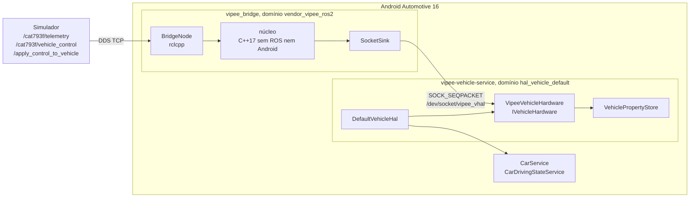

# ct-speed-slice Design

**Spec**: `.specs/features/ct-speed-slice/spec.md`
**Status**: Approved

---

## Architecture Overview

O processo ROS (`vendor_vipee_ros2`, AD-012) roda o núcleo da ponte: lê o mapa do veículo, traduz as mensagens, cuida do dado velho e decide valor e status de cada propriedade. Ele entrega o resultado pronto a um VHAL próprio e fino por um socket Unix `SOCK_SEQPACKET` (AD-013 proposta). O VHAL só guarda o último valor, responde `getValues` e repassa eventos ao `DefaultVehicleHal` do AOSP. Se o socket cair ou ficar mudo, ele mesmo marca tudo `UNAVAILABLE`.



Fluxo de uma mensagem: callback ROS ➔ `Bridge::onTelemetry(msg, now)` ➔ núcleo traduz e compara com o último valor ➔ `PropertySink::publish(update)` só se mudou (ou sempre, para a contínua) ➔ registro de 32 bytes no socket ➔ `VehiclePropertyStore::writeValue` ➔ evento para os assinantes.

O dado velho é verificado no núcleo por `Bridge::tick(now)`, chamado por um timer ROS de 50 ms. Callbacks e timer rodam no mesmo `SingleThreadedExecutor`, então o núcleo não precisa de lock.

---

## Code Reuse Analysis

### Existing Components to Leverage

| Component | Location | How to Use |
| --------- | -------- | ---------- |
| `DefaultVehicleHal` | `~/aosp/hardware/interfaces/automotive/vehicle/aidl/impl/current/vhal` | Servidor AIDL `IVehicle` inteiro (subscribe, heartbeat `VHAL_HEARTBEAT`, permissões); nós só escrevemos o `IVehicleHardware` |
| `EmulatedVehicleService.cpp` | `~/aosp/device/generic/car/emulator/vhal_aidl/` | Molde do `main()` do serviço (thread pool binder, `AServiceManager_addService("…IVehicle/default")`) e do `Android.bp` (defaults `VehicleHalDefaults`) |
| `VehiclePropertyStore` | `…/impl/current/utils/common` (`VehicleHalUtils`) | Guarda valor e status por propriedade, thread-safe, com `EventMode::ON_VALUE_CHANGE` (não emite evento se nada mudou) |
| `JsonConfigLoader` | `…/impl/current/default_config` | Lê as configs das 4 propriedades de um JSON no formato do `DefaultProperties.json`, em vez de tabela em código |
| `twist_listener.cpp` + `CMakeLists.txt` | `tools/jazzy/bringup/` | Molde do nó NDK (toolchain, `c++_static`, `max-page-size=16384`) |
| `install-vendor.sh`, `sepolicy-sync.sh`, `sepolicy/` | `tools/jazzy/` | Mesmo caminho de instalação e de política; ganham o socket e o serviço VHAL |
| Parâmetros ROS (`--params-file`) | `rclcpp` | O mapa do veículo é um YAML de parâmetros ROS: zero dependência nova (só `libyaml` C existe no install Android; não há `yaml-cpp`) |

### Integration Points

| System | Integration Method |
| ------ | ------------------ |
| Simulador | Assina `/<ns>/telemetry` (`SirvVehicleTelemetry`), `/<ns>/vehicle_control` (`CAT793FVehicleControl`, só no CAT793F) e `/apply_control_to_vehicle` (`SirvVehicleControl`). Exige cross-build de `sirv_msgs` |
| CarService | Lê as 4 propriedades pelo `IVehicle/default`. `CarDrivingStateService` exige exatamente `PERF_VEHICLE_SPEED`, `GEAR_SELECTION`, `PARKING_BRAKE_ON` (`CarDrivingStateService.java:73-77`) |
| Emulador | O `vipee-vehicle-service` substitui o `V4-emulator-service` (mesma instância `IVehicle/default`; os dois não podem rodar juntos) |

---

## Components

### Núcleo (`core/`)

- **Purpose**: traduzir mensagens em valor e status das 4 propriedades, pelo mapa, com dado velho e fail-loud.
- **Location**: `core/include/vipee/`, `core/src/`, `core/test/` (CMake + vcpkg + GoogleTest no host; os mesmos fontes entram no build NDK do nó).
- **Interfaces**:
  - `Result<VehicleMap> validateMap(const VehicleMap&)` - checa versão, campos obrigatórios, tabela da alavanca e propriedades dentro das 4 (CTS-23).
  - `Bridge(VehicleMap, PropertySink&, Logger&)` - sem mapa válido, publica as 4 `UNAVAILABLE` com `MAP_INVALID`.
  - `void onTelemetry(const TelemetryIn&, int64_t now_ns)` - `speed` km/h com sinal, `gear` engatada.
  - `void onLever(const LeverIn&, int64_t now_ns)` - `transmission` ASCII; ignorado se o mapa não tem alavanca.
  - `void onControl(const ControlIn&, int64_t now_ns)` - `id`, `handbrake`; guarda o último `id` e o instante, para detectar fonte ambígua (CTS-18).
  - `void tick(int64_t now_ns)` - aplica o limite de dado velho.
  - `struct PropertySink { virtual void publish(const PropertyUpdate&) = 0; }`
  - `struct Logger { virtual void transition(int32_t prop, Status, Reason) = 0; }`
- **Dependencies**: só stdlib. `TelemetryIn`/`LeverIn`/`ControlIn` são structs próprias; o nó copia os campos das mensagens ROS.
- **Reuses**: nada; é o código novo de domínio.

### BridgeNode (`ros/vipee_bridge/`)

- **Purpose**: processo vendor que liga ROS ao núcleo e o núcleo ao socket.
- **Location**: `ros/vipee_bridge/` (`main.cpp`, `CMakeLists.txt`, `vipee_bridge.rc`), cross-build no contêiner Jazzy.
- **Interfaces**:
  - lê os parâmetros do mapa (`--params-file /vendor/etc/vipee/maps/<veículo>.yaml`) para um `VehicleMap`; parâmetro ausente ou de tipo errado vira mapa inválido, não exceção fatal.
  - `SocketSink : PropertySink` - conecta em `/dev/socket/vipee_vhal`, reconecta a cada 500 ms, envia heartbeat a cada 100 ms; ao reconectar, reenvia o estado atual das 4.
  - `LogcatLogger : Logger` - `__android_log_print(…, "vipee_bridge", …)` (CTS-19).
  - relógio: `clock_gettime(CLOCK_BOOTTIME)`, a mesma base do `elapsedRealtimeNano()` (CTS-09).
- **Dependencies**: `rclcpp`, `sirv_msgs` (cross-build), `liblog` do NDK.
- **Reuses**: `tools/jazzy/bringup/` (CMake, toolchain), `vipee_twist_listener.rc`.

### Protocolo do socket (`core/include/vipee/wire.h`)

- **Purpose**: único contrato entre os dois processos; header C++ sem dependências, compilado pelos dois lados.
- **Interfaces**: registro fixo de 32 bytes, little-endian, um por datagrama:

```cpp
struct WireRecord {      // 32 bytes
  uint16_t version;      // kWireVersion = 1; versão diferente = VHAL descarta e loga
  uint16_t kind;         // 1 = update, 2 = heartbeat
  int32_t  prop_id;      // VehicleProperty (0 no heartbeat)
  int32_t  status;       // VehiclePropertyStatus: AVAILABLE 0, UNAVAILABLE 1, ERROR 2
  int32_t  int_value;    // GEAR_*, ou 0/1 do freio de mão
  float    float_value;  // PERF_VEHICLE_SPEED em m/s
  int32_t  reserved;
  int64_t  timestamp_ns; // CLOCK_BOOTTIME da chegada da mensagem ROS
};
```

### VipeeVehicleHardware (`android/vhal/`)

- **Purpose**: `IVehicleHardware` fino: declara as 4 propriedades, guarda o que chega pelo socket, responde leituras.
- **Location**: `android/vhal/` (`VipeeVehicleHardware.{h,cpp}`, `VehicleService.cpp`, `Android.bp`, `vipee-vehicle-service.rc`, `vipee_properties.json`, VINTF xml), sincronizado para `$ANDROID_BUILD_TOP/device/generic/car/emulator/vipee_vhal/`.
- **Interfaces**:
  - `getAllPropertyConfigs()` - as 4 configs do `vipee_properties.json` (`PERF_VEHICLE_SPEED` CONTINUOUS, `minSampleRate` 1, `maxSampleRate` 10; as outras ON_CHANGE; todas READ).
  - `getValues()` - status `AVAILABLE` devolve o valor; `UNAVAILABLE` devolve `StatusCode::NOT_AVAILABLE`; `ERROR` devolve `StatusCode::INTERNAL_ERROR` (regra do `VehiclePropertyStatus.aidl`: resultado de get é sempre `AVAILABLE`, o resto vira código de erro).
  - eventos de assinatura - levam o `VehiclePropValue` com o status (`UNAVAILABLE`/`ERROR`), como pede a AIDL.
  - `setValues()` - `StatusCode::ACCESS_DENIED` (todas READ).
  - `checkHealth()` - `OK` enquanto o socket tem par vivo.
  - `subscribe()`/`updateSampleRate()` - guarda a taxa da contínua; a velocidade chega a ~66 Hz e é dizimada para a taxa pedida.
  - watchdog - sem registro nem heartbeat por 300 ms, ou socket fechado: as 4 viram `UNAVAILABLE`.
- **Dependencies**: `DefaultVehicleHal`, `VehicleHalUtils`, `JsonConfigLoader`, `libbinder_ndk`, `liblog`, `libcutils` (`android_get_control_socket`).
- **Reuses**: `EmulatedVehicleService.cpp`, `VehiclePropertyStore`.

### Mapas (`maps/`)

- **Purpose**: tudo que varia por veículo, versionado.
- **Location**: `maps/cat793f.yaml`, `maps/commander.yaml`, instalados em `/vendor/etc/vipee/maps/`.

---

## Data Models

### Mapa do veículo (parâmetros ROS)

```yaml
vipee_bridge:
  ros__parameters:
    map_version: 1
    vehicle: cat793f
    namespace: cat793f              # /cat793f/telemetry, /cat793f/vehicle_control
    stale_ms: 500
    speed:
      source: telemetry.speed
      scale: 0.277777778            # km/h ➔ m/s
      max_abs_kmh: 80.0             # inclusivo
    current_gear:
      source: telemetry.gear        # tabela genérica fixa: <0 R, 0 N, 1..9 GEAR_n
    gear_selection:
      source: lever                 # lever | derived
      lever_codes: [80, 82, 78, 68, 49, 50]
      lever_gears: [PARK, REVERSE, NEUTRAL, DRIVE, GEAR_1, GEAR_2]
    parking_brake:
      source: apply_control_to_vehicle.handbrake
```

No `commander.yaml`: `namespace: commander`, `max_abs_kmh: 220.0`, `gear_selection.source: derived`, sem `lever_*`.

### Estado por propriedade (núcleo)

```cpp
struct PropertyState {
  Status status = Status::kUnavailable;  // kAvailable | kUnavailable | kError
  Reason reason = Reason::kNoData;       // kNone | kNoData | kStale | kOutOfRange | kUnknownGear | kAmbiguousSource | kMapInvalid
  int32_t int_value = 0;
  float float_value = 0.f;
  int64_t source_rx_ns = -1;             // última mensagem válida da fonte
};
```

`GEAR_SELECTION` derivada herda a validade da telemetria; com alavanca, só a da alavanca (CTS-14).

---

## Error Handling Strategy

| Error Scenario | Handling | User Impact |
| -------------- | -------- | ----------- |
| Sem mensagem desde o início | Estado inicial `UNAVAILABLE`/`NO_DATA` | `get` devolve `NOT_AVAILABLE` |
| Fonte parada > `stale_ms` | `tick` marca `UNAVAILABLE`/`STALE` e loga | Dashboard vê indisponível em ≤ 550 ms |
| `speed` NaN, inf ou acima do máximo | `PERF_VEHICLE_SPEED` `ERROR`/`OUT_OF_RANGE` | `get` devolve `INTERNAL_ERROR` |
| `gear` fora de -9..9, código de alavanca fora da tabela | `UNAVAILABLE`/`UNKNOWN_GEAR` | Indisponível, sem chute de P |
| Dois `id` de controle dentro do `stale_ms` | `PARKING_BRAKE_ON` `UNAVAILABLE`/`AMBIGUOUS_SOURCE` | Indisponível até um `stale_ms` com um só `id` |
| Mapa inválido | 4 `UNAVAILABLE`/`MAP_INVALID`, processo segue vivo | Indisponível até corrigir o mapa |
| Processo ROS morre ou trava | VHAL: socket fechado ou 300 ms sem heartbeat ➔ 4 `UNAVAILABLE` | Indisponível; o init reinicia o processo |
| VHAL reinicia | `SocketSink` reconecta e reenvia o estado atual | Breve `NOT_AVAILABLE` |
| Registro com `version` diferente | VHAL descarta e loga uma vez | Indisponível (fail-loud) |

---

## Risks & Concerns

| Concern | Location (file:line) | Impact | Mitigation |
| ------- | -------------------- | ------ | ---------- |
| `id` do `SirvVehicleControl` não é fixo (uid do spawn, `LV_identifier`, `SirvVehicleSimulator.cpp:1363`) e a telemetria não traz id | `generic_logic.cpp:124` | Não dá para filtrar por `id` do mapa | Spec ajustado (CTS-18, 2026-10-30): aceita qualquer `id`; dois `id` dentro do `stale_ms` ➔ `UNAVAILABLE`/`AMBIGUOUS_SOURCE`. Definitivo: estado do freio de mão em `/<ns>/` (P3) quando o contrato fechar |
| Trocar o VHAL do emulador remove ~todas as propriedades fake (HVAC, portas, etc.) | `device/generic/car/emulator/car_emulator_vendor.mk:55` | Partes do SystemUI/launcher podem mostrar erro ou sumir | Esperado (AD-009). Primeira task Android é um VHAL esqueleto com as 4 propriedades e teste de boot, para descobrir cedo. No emulador o binário vai por push no caminho do `V4-emulator-service`, herdando o rótulo `hal_vehicle_default_exec` sem mexer em `file_contexts`; editar o `.mk` só com aprovação |
| Propriedades de plataforma ausentes | `CarPowerManagementService.java:661-667`, `PowerHalService.java:618` | Sem `AP_POWER_STATE_REQ` o CPMS só avisa e vai para ON; outros serviços não verificados | AD-014 proposta: declarar nenhuma; o teste de boot confere `dumpsys car_service` e driving state. Se algum serviço falhar, a propriedade entra numa tabela documentada com valor fixo |
| Taxa da contínua | `DefaultVehicleHal` não dizima eventos | Velocidade a ~66 Hz excede `maxSampleRate` 10 | Hardware dizima pela taxa assinada |
| Dois builds novos (NDK do nó, Soong do VHAL) e política SELinux nova | `tools/jazzy/sepolicy/` | Cada `m selinux_policy` ~30 min e até ~28 GB de VHDX no C: | Uma só rodada de política (socket + `dontaudit proc_net`); aprovação e `df /mnt/c` antes. VHDX esparso no Windows (`wsl --manage <distro> --set-sparse true`) devolve o espaço. TCP em loopback dispensaria política, mas rejeitado: qualquer app com `INTERNET` injetaria valores |
| `sirv_msgs` no NDK: **resolvido no spike de 2026-10-30**. Compilou com `diagnostic_msgs` (declarado, não usado) em 38 s; `llvm-readelf` sem `.so.N` de fora do install e `LOAD` alinhado a `0x4000` | `SIRV-Simulator/sirv_ros_pkgs/sirv_msgs` | Nenhum | Task de build vira cópia do spike para `tools/jazzy/build-android.sh` (base path do `sirv_msgs`) |
| Imagem do RPi5 precisa ser compilada (VHAL próprio, política SELinux); raspberry-vanilla `android-16.0` usa `android.hardware.automotive.vehicle@V4-default-service` (`FakeVehicleHardware`) e `android.hardware.automotive.evs-v4l2` | `aosp_rpi5_car.mk:74-117` (raspberry-vanilla) | AOSP arm64 completo não cabe nos 51 GB livres do C: | Build em outra máquina; em último caso, VM na AWS. Fora desta fatia, mas o módulo VHAL e a política são agnósticos de device para portar sem mudança |

---

## Tech Decisions

| Decision | Choice | Rationale |
| -------- | ------ | --------- |
| Onde fica a lógica | No processo ROS (núcleo C++17); VHAL só guarda e repassa | Núcleo testável no host sem ROS nem Android (AGENTS.md §3); VHAL igual ao de um veículo real |
| IPC | `SOCK_SEQPACKET` em `/dev/socket/vipee_vhal`, criado pelo init no `.rc` do VHAL; o nó conecta | Mantém fronteira de mensagem sem framing; VHAL sobe em `early_hal`, antes do nó; política SELinux de uma linha (`unix_socket_connect`). Ver AD-013 |
| Protocolo | Registro binário fixo de 32 bytes, versionado | 4 propriedades escalares; protobuf exigiria lib no NDK |
| Formato do mapa | YAML de parâmetros ROS | Já suportado pelo `rclcpp`; sem `yaml-cpp` no Android |
| Configs VHAL | JSON lido pelo `JsonConfigLoader` | Reuso; configs ficam fora do código |
| Dado velho | `tick` a cada 50 ms no núcleo + watchdog de 300 ms no VHAL | Núcleo cobre fonte parada; VHAL cobre processo morto ou travado |

### Decisões de projeto propostas (entram no `STATE.md` com a aprovação)

- **AD-013**: o processo ROS entrega valor e status prontos ao VHAL por `SOCK_SEQPACKET` (`/dev/socket/vipee_vhal`, registro fixo versionado em `core/include/vipee/wire.h`). O VHAL é `DefaultVehicleHal` + `IVehicleHardware` próprio, fino, com watchdog. Rejeitados: `GRPCVehicleHardware` (gRPC no NDK, API `VehicleServer` inteira) e AIDL vendor (VINTF e servicemanager para 4 escalares). Detalha AD-008/AD-009/AD-012.
- **AD-014**: o VHAL não declara propriedades de plataforma sem fonte no simulador. Conferido no AOSP 16: sem `AP_POWER_STATE_REQ` o CPMS vai direto para ON. Se um serviço exigir alguma, ela entra numa tabela documentada no `android/vhal/` com valor fixo e justificativa; nunca sinal de veículo. Ajusta AD-009 sem revogá-la.
