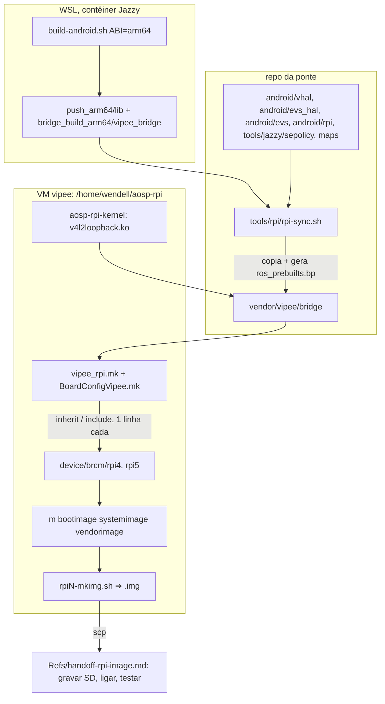

# rpi-image Design

**Spec**: `.specs/features/rpi-image/spec.md`
**Status**: Draft

Abordagem escolhida por Wendell (2026-11-04): ponte **embutida no build** da imagem (camada vendor na árvore `aosp-rpi`) e SELinux **enforcing** com recuo documentado (`androidboot.selinux=permissive` no `cmdline.txt` do SD). Alternativas descartadas: imagem stock + `adb push` (não serve de imagem de demo; o SD regravado perde a ponte) e híbrida (mesmo problema para as libs ROS).

---

## Architecture Overview

Na placa, o fluxo é o do emulador: `vipee_bridge` (domínio `vendor_vipee_ros2`) disca o host por TCP, escreve no socket `/dev/socket/vipee_vhal` do VHAL da ponte e nos `/dev/video*` do `v4l2loopback`, lidos pela HAL `vipee-evs-v4l2`. Muda só o endereço do host, lido de propriedade.

---

## Code Reuse Analysis

### Existing Components to Leverage

| Component | Location | How to Use |
| --------- | -------- | ---------- |
| Build cruzado ROS + ponte | `tools/jazzy/build-android.sh`, `build-bridge.sh`, `android_x86_64.toolchain.cmake` | Parametrizar a ABI (`ABI=x86_64` padrão, `arm64`); diretórios com sufixo da ABI, como já são (`*_x86_64`) |
| VHAL da ponte | `android/vhal/` | Mesmo código; novo alvo `vipee-vehicle-service-rpi` com `.rc`, fragmento VINTF e `overrides` do VHAL padrão da placa |
| HAL EVS fork | `android/evs_hal/` | Mesmo código; alvo instalado pelo produto com `overrides: ["android.hardware.automotive.evs-v4l2"]` |
| Config EVS, ueventd, init EVS | `android/evs/` | Reusados; o `init` da placa carrega o `v4l2loopback` do vendor |
| Política SELinux | `tools/jazzy/sepolicy/` | Mesma pasta como `BOARD_VENDOR_SEPOLICY_DIRS`; acrescenta o rótulo do VHAL em `/vendor/bin/hw/` e a propriedade do host |
| Mapas de veículo, `.rc` da ponte, XML Cyclone | `maps/`, `tools/jazzy/vendor/vipee_bridge.rc`, `tools/jazzy/config/` | Instalados por módulos `prebuilt_etc`; o XML da placa ganha `${VIPEE_HOST}` |
| Sync para árvore AOSP | `tools/emu/vhal-sync.sh`, `evs-sync.sh` | Mesmo padrão em `tools/rpi/rpi-sync.sh` (copia para `vendor/vipee/bridge`, escreve só na VM) |
| `v4l2loopback` | `common-modules/virtual-device` do kernel Android (origem do módulo do emulador) | Compilado fora da árvore contra o kernel da placa |
| Testes no device | `tools/emu/test-e2e.sh`, `test-vhal.sh`, `vipee_evs_probe` | Base dos passos de conferência do handoff (adb pela USB) |

### Integration Points

| System | Integration Method |
| ------ | ------------------ |
| Produto `aosp_rpi{4,5}_car` | `rpi-sync.sh` acrescenta, de forma idempotente, `$(call inherit-product, vendor/vipee/bridge/vipee_rpi.mk)` ao `aosp_rpiN_car.mk` e `-include vendor/vipee/bridge/BoardConfigVipee.mk` ao `BoardConfig.mk` |
| VHAL da placa | `overrides` tira o `android.hardware.automotive.vehicle@V4-default-service`; o nosso registra `IVehicle/default` |
| EVS da placa | `overrides` tira a `evs-v4l2` stock; o `init.evs.rc` do sistema (evsmanagerd) fica; a instância é `IEvsEnumerator/hw/1` nas duas (conferido em 2026-11-04) |
| Kernel da placa | `.ko` no `/vendor/lib/modules`; `modprobe`/`insmod` no `early-boot` pelo `.rc` da ponte |

---

## Components

### ABI no build cruzado

- **Purpose**: gerar ROS 2 Jazzy, `sirv_msgs`, libjpeg-turbo e `vipee_bridge` para `arm64-v8a`.
- **Location**: `tools/jazzy/build-android.sh`, `build-bridge.sh`, novo `tools/jazzy/android_arm64.toolchain.cmake`.
- **Interfaces**: `ABI=arm64 tools/jazzy/run.sh /bridge/tools/jazzy/build-android.sh`; saídas `install_android_arm64`, `bridge_build_arm64`, `push_arm64/lib`. Sem `ABI`, saída idêntica à de hoje.
- **Dependencies**: NDK r27 do contêiner; `libc++_shared.so` de `aarch64-linux-android`.
- **Reuses**: toolchain x86_64 (troca `ANDROID_ABI`); link com `-Wl,-z,max-page-size=16384` no arm64 (o handoff de 2026-10 viu `LOAD segment not aligned` no RPi4 com AAOS 16).

### Endereço do host

- **Purpose**: a ponte disca o host da LAN sem recompilar (RPI-05, RPI-06).
- **Location**: `ros/vipee_bridge/src/main.cpp` (Android), `tools/jazzy/config/cyclonedds_rpi.xml`.
- **Interfaces**:
  - Propriedade `persist.vendor.vipee.host` (IPv4 ou nome). Na partida, `main` copia o valor para a variável `VIPEE_HOST`; o XML da placa usa `<Peer Address="${VIPEE_HOST}:7400"/>` (o CycloneDDS expande variáveis nos valores da configuração, `ddsi_config.c:2038`).
  - Se o XML em uso contém `${VIPEE_HOST}` e a propriedade está vazia: loga `DDS_PEER_UNSET` (erro), não inicia o DDS, mantém o processo vivo e parado (sem laço de reinício do `init`). O VHAL fica sem dado, ou seja, `UNAVAILABLE` (AD-017).
  - O XML do emulador não muda (`10.0.2.2` fixo); a regra só atua se o XML tiver a variável.
- **Dependencies**: `__system_property_get` (libc do Android).
- **Reuses**: `logError` do `main.cpp`.

### Camada vendor `vendor/vipee/bridge`

- **Purpose**: tudo que a ponte põe na imagem.
- **Location (repo)**: `android/rpi/` (`vipee_rpi.mk`, `BoardConfigVipee.mk`, `Android.bp` dos prebuilts fixos, `init.vipee_rpi.rc`); `tools/rpi/rpi-sync.sh` monta a pasta na VM.
- **Interfaces**:
  - `vipee_rpi.mk`: `PRODUCT_PACKAGES` com `vipee_bridge`, as libs ROS, `vipee-vehicle-service-rpi`, `vipee_properties.json`, `vipee-evs-v4l2`, `vipee_evs_probe`, configs, mapas; `PRODUCT_COPY_FILES` do `.ko` e do `ueventd` da ponte.
  - `BoardConfigVipee.mk`: `BOARD_VENDOR_SEPOLICY_DIRS += vendor/vipee/bridge/sepolicy`; remove `androidboot.selinux=permissive` de `BOARD_KERNEL_CMDLINE`.
  - `ros_prebuilts.bp`, gerado por `rpi-sync.sh` a partir de `push_arm64/lib`: um `cc_prebuilt_library_shared` por lib (`vendor: true`, `check_elf_files: false`), e `cc_prebuilt_binary` `vipee_bridge` com `init_rc`. Gerado porque a lista de libs vem do build ROS; o gerador é versionado e testado.
- **Dependencies**: saída do build arm64; `.ko` do kernel.
- **Reuses**: `.rc`, XML e mapas do emulador.

### `v4l2loopback` para o kernel da placa

- **Purpose**: os `/dev/video*` da AD-015 na placa (P2).
- **Location**: árvore de kernel `/home/wendell/aosp-rpi-kernel` na VM (manifesto `common-android16-6.12` + `android_kernel_manifest` do raspberry-vanilla); script `tools/rpi/build-kernel-module.sh`.
- **Interfaces**: produz `v4l2loopback.ko` por placa; o `rpi-sync.sh` o copia. Se o módulo não casar com o kernel pré-compilado (vermagic), o kernel inteiro é recompilado e substitui `device/brcm/rpiN-kernel` (README do raspberry-vanilla).
- **Dependencies**: kleaf (`tools/bazel`).

### Imagem e entrega

- **Purpose**: `.img` gravável e handoff.
- **Location**: `tools/rpi/build-image.sh` (roda na VM no `tmux` "rpi": `lunch aosp_rpiN_car-bp4a-userdebug`, `m bootimage systemimage vendorimage`, `./rpiN-mkimg.sh`, `xz`), `Refs/handoff-rpi-image.md`.
- **Interfaces**: `tools/rpi/build-image.sh rpi4|rpi5`; avisa AVM e CalibDroid antes (um `m` por vez na VM, SHARED.md).

---

## Error Handling Strategy

| Error Scenario | Handling | User Impact |
| -------------- | -------- | ----------- |
| `persist.vendor.vipee.host` vazia | `DDS_PEER_UNSET` no logcat; processo parado sem reiniciar | Propriedades `UNAVAILABLE`; o handoff manda definir e reiniciar |
| Host inalcançável | CycloneDDS tenta de novo sozinho; ponte não reinicia | `UNAVAILABLE` até a rede voltar |
| `v4l2loopback` ausente ou não carrega | `DEVICE_UNAVAILABLE` por câmera (já existe); telemetria segue | Sem câmeras; handoff tem o diagnóstico |
| Boot não termina em enforcing | Recuo: `androidboot.selinux=permissive` no `cmdline.txt` do FAT | Placa sobe; o handoff pede o `dmesg`/`logcat` de `avc` para corrigir |
| Build de uma placa falha | Entrega a outra; registra no `STATE.md` | Imagem parcial |

---

## Risks & Concerns

| Concern | Location (file:line) | Impact | Mitigation |
| ------- | -------------------- | ------ | ---------- |
| Colisão confirmada: no RPi4 os codecs ocupam `/dev/video10`, `11`, `12`, `18`, `19` e `31` (`device/brcm/rpi4/ramdisk/ueventd.rpi4.rc:18-29`) | `maps/*.yaml:23-44`, `android/evs/*`, `android/evs/rro/res/values/config.xml:7-10`, `tools/emu/test-cam.sh` | `v4l2loopback` não pega os números; câmeras erradas ou codec quebrado | AD-021: as câmeras da ponte passam a `/dev/video40..43` em todos os lugares, emulador incluso (uma configuração só, versionada). Task própria, com reinstalação no emulador combinada com AVM e CalibDroid |
| Instância da HAL EVS | `manifest_android.hardware.automotive.evs-v4l2.xml` da placa: `IEvsEnumerator/hw/1`, igual ao fork | — | Resolvido (2026-11-04): mesma instância; na placa o `.rc` do fork substitui o `android.hardware.automotive.evs-v4l2.rc` (mesmo `onrestart` do `evsmanagerd` do sistema) |
| Raspberry-vanilla nunca rodou enforcing no nosso conhecimento | `device/brcm/rpi4/BoardConfig.mk:59` | Boot preso | Recuo pelo `cmdline.txt`; critério da ponte é zero `avc: denied` nos domínios dela |
| Libs ROS sem `check_elf_files` | `ros_prebuilts.bp` gerado | Dependência faltando passa no build | Teste do gerador confere que toda `NEEDED` de cada lib está na lista ou no sistema (RPI-04) |
| Branch `android-16.0` do raspberry-vanilla sem manutenção | README do `android_local_manifest` | Sem correções upstream | Aceito: casa com a base `r4` do emulador; AD registra |
| Disco da VM | 346 GB livres, árvore + `out` + kernel ~280 GB | Build para por falta de espaço | Clone raso; `out/` de uma placa limpo depois de copiar a imagem, se faltar |
| Sem placa para o agente testar | — | Defeitos só aparecem no teste do Wendell | Handoff com saída esperada por passo; checagens estáticas da imagem (`lpunpack`/`debugfs`, `readelf`) antes de entregar |

---

## Tech Decisions

| Decision | Choice | Rationale |
| -------- | ------ | --------- |
| Base da imagem | raspberry-vanilla `android-16.0` sobre `android-16.0.0_r4`, `bp4a` | Mesma base do emulador; revê a AD-005 (`bp2a`/`r1`) ➔ AD-019 |
| Ponte na imagem | Camada `vendor/vipee/bridge` com módulos Soong e `overrides`; SELinux enforcing com recuo pelo `cmdline.txt` | Escolha do Wendell ➔ AD-020 |
| Endereço do host | `persist.vendor.vipee.host` + `${VIPEE_HOST}` no XML | Sobrevive a reboot, muda por `setprop`, sem tocar no emulador |
| Libs ROS como prebuilts | `.bp` gerado da saída do build | A lista muda com o build ROS; escrever à mão diverge |
| Números das câmeras | `/dev/video40..43` em todos os alvos | Colisão com os codecs do RPi4 ➔ AD-021 |
| Página de 16 KB | `-z max-page-size=16384` no arm64 | Compatível com 4 KB e 16 KB; evita o aviso visto no RPi4 |
