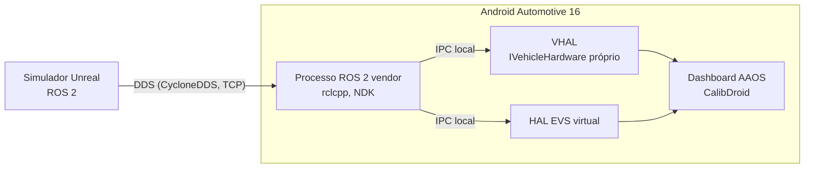

# VIPEE ROS2AAOSBridge

**Versão:** 0.0.0 (pré-MVP; spikes de ROS 2 no Android validados no emulador)

Ponte entre um simulador veicular em ROS2 e o Android Automotive (AAOS). Lê tópicos, serviços e ações do ROS2 e os injeta no AAOS: telemetria vira propriedade do **VHAL**, câmeras viram streams do **EVS**. O dashboard do veículo roda acoplado à simulação sem saber que a fonte é simulada, então as funções desenvolvidas no simulador vão para o veículo real trocando só o backend das HALs.

> **Nova direção (2026-10-28): o ROS 2 roda dentro do Android.** Partindo do handoff de um colega ([`Refs/handoff-ros2-jazzy-aaos.md`](Refs/handoff-ros2-jazzy-aaos.md)), compilamos ROS 2 **Jazzy** com **CycloneDDS** para Android (NDK r27). No emulador AAOS 16, em SELinux **Enforcing**, um processo nativo iniciado pelo `init` como serviço vendor, no domínio próprio `vendor_vipee_ros2`, assina tópicos publicados no host. Não há mais nó de ponte no host nem protocolo WebSocket próprio: o simulador fala DDS direto com o Android. A arquitetura anterior (nó Humble no host + WebSocket/protobuf, AD-001 a AD-003 e AD-006) foi substituída pelas AD-011 e AD-012.

## Arquitetura

* **Android, processo ROS 2:** um único binário nativo (`rclcpp` + `rmw_cyclonedds_cpp`, cross-build com NDK) roda como serviço vendor (`.rc` + domínio SELinux `vendor_vipee_ros2`). Assina os tópicos do simulador e os traduz por um mapa tabelado e versionado. Um só participante DDS por device, porque a descoberta TCP com dial-out só suporta um.
* **Descoberta:** CycloneDDS só por TCP, sem multicast. O host escuta na porta 7400 e o Android disca para ele (no emulador, `10.0.2.2:7400`). `ROS_DOMAIN_ID=25`.
* **HALs:** o VHAL usa o `DefaultVehicleHal` do AOSP com um `IVehicleHardware` próprio, e uma HAL EVS virtual entrega as 4 câmeras (`FRONTVIEW`, `REARVIEW`, `LEFTVIEW`, `RIGHTVIEW`). As HALs recebem os dados do processo ROS por IPC local, a definir. Acima da fronteira HAL, o Android vê um veículo comum.
* **Fail-loud:** sinal ausente ou velho vira `UNAVAILABLE` no VHAL e para o stream no EVS. Nunca há valor padrão ou frame congelado.

Estado validado (emulador, AOSP `android-16.0.0_r4`): `geometry_msgs/TwistStamped` do host chega ao serviço vendor em Enforcing, primeira mensagem em ~0,4 s. Ainda pendente: IPC até VHAL/EVS, vídeo 720p e build arm64 no RPi5.

As decisões e suas razões estão em [`.specs/STATE.md`](.specs/STATE.md) (AD-001 a AD-012).

## Sinais do MVP

| Sinal | Propriedade VHAL | Uso no dashboard |
| ----- | ---------------- | ---------------- |
| Marcha | `GEAR_SELECTION`, `CURRENT_GEAR` | Câmera de ré exigida por legislação |
| Velocidade | `PERF_VEHICLE_SPEED` | Decisão de solicitar câmera |
| Portas | `DOOR_POS` | Corte do sinal do BEV |
| Retrovisores | `MIRROR_FOLD` | Corte do sinal do BEV |
| 4 câmeras 720p | EVS | Dashboard, AVM e calibração (CalibDroid) |

O que o simulador publica está em [`docs/sim-contract.md`](docs/sim-contract.md) (rascunho v0.1, em negociação com o time do simulador). A v0.2 vai partir das mensagens `sirv_msgs` e dos tópicos do handoff (ex.: `/sirv/sensor/fisheye/<pos>/image/compressed`).

## Etapas de validação

1. Emulador AAOS (AOSP `android-16.0.0_r4`).
2. Mula Raspberry Pi 5 com AAOS 16 (`aosp_rpi5_car`, raspberry-vanilla; ver [`Refs/android-auto-RPi5.pdf`](Refs/android-auto-RPi5.pdf)). **Demo para o stakeholder em 2026-11-28.**
3. Veículo de engenharia (Qualcomm SA6155P).

## Dependências

* Docker: ROS 2 Jazzy, NDK r27 e o cross-build ficam no contêiner `vipee/ros2-jazzy-android` (`tools/jazzy/run.sh`, scripts em [`tools/jazzy/`](tools/jazzy/)). O host continua Ubuntu 22.04.
* Árvore AOSP 16 em `$ANDROID_BUILD_TOP` e `adb` (política SELinux ligada por `tools/jazzy/sepolicy-sync.sh`).
* Python 3.10 e `uv` para ferramentas auxiliares.

O setup completo, as variáveis de ambiente e as armadilhas do ambiente estão no [`AGENTS.md`](AGENTS.md) §6. Os comandos de build entram aqui junto com o primeiro código.

## Projetos irmãos

* [`VIPEE-CalibDroid`](https://github.com/Robsic/VIPEE-CalibDroid): app AAOS de calibração extrínseca; consome as 4 câmeras desta ponte.
* [`VIPEE-SynthCamStream`](https://github.com/Robsic/VIPEE-SynthCamStream): publica o dataset WoodScape como 4 tópicos ROS2; fonte de câmeras para teste.
* [`VIPEE-UndistortDemo`](https://github.com/Robsic/VIPEE-UndistortDemo): runtime AVM, consumidor final das câmeras.

## Contribuindo

Desenvolvimento por especificação (skill `tlc-spec-driven`), testes RED-GREEN-REFACTOR e Conventional Commits. Regras completas no [`AGENTS.md`](AGENTS.md).
