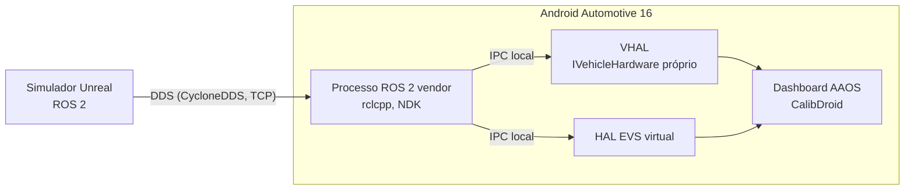

# VIPEE ROS2AAOSBridge

**Versão:** 0.0.0 (pré-MVP; spikes de ROS 2 no Android validados no emulador)

Ponte entre um simulador veicular em ROS2 e o Android Automotive (AAOS). Lê tópicos, serviços e ações do ROS2 e os injeta no AAOS: telemetria vira propriedade do **VHAL**, câmeras viram streams do **EVS**. O dashboard do veículo roda acoplado à simulação sem saber que a fonte é simulada, então as funções desenvolvidas no simulador vão para o veículo real trocando só o backend das HALs.

> **Nova direção (2026-10-28): o ROS 2 roda dentro do Android.** Partindo do handoff de um colega ([`Refs/handoff-ros2-jazzy-aaos.md`](Refs/handoff-ros2-jazzy-aaos.md)), compilamos ROS 2 **Jazzy** com **CycloneDDS** para Android (NDK r27). No emulador AAOS 16, em SELinux **Enforcing**, um processo nativo iniciado pelo `init` como serviço vendor, no domínio próprio `vendor_vipee_ros2`, assina tópicos publicados no host. Não há mais nó de ponte no host nem protocolo WebSocket próprio: o simulador fala DDS direto com o Android. A arquitetura anterior (nó Humble no host + WebSocket/protobuf, AD-001 a AD-003 e AD-006) foi substituída pelas AD-011 e AD-012.

## Arquitetura



* **Android, processo ROS 2:** um único binário nativo (`rclcpp` + `rmw_cyclonedds_cpp`, cross-build com NDK) roda como serviço vendor (`.rc` + domínio SELinux `vendor_vipee_ros2`). Assina os tópicos do simulador e os traduz por um mapa tabelado e versionado. Um só participante DDS por device, porque a descoberta TCP com dial-out só suporta um.
* **Descoberta:** CycloneDDS só por TCP, sem multicast. O host escuta na porta 7400 e o Android disca para ele (no emulador, `10.0.2.2:7400`). `ROS_DOMAIN_ID=25`.
* **HALs:** o VHAL usa o `DefaultVehicleHal` do AOSP com um `IVehicleHardware` próprio, e uma HAL EVS virtual entrega as 4 câmeras (`FRONTVIEW`, `REARVIEW`, `LEFTVIEW`, `RIGHTVIEW`). O VHAL recebe valor e status prontos do processo ROS por um socket `SOCK_SEQPACKET` em `/dev/socket/vipee_vhal` (AD-013); o IPC até o EVS está a definir. Acima da fronteira HAL, o Android vê um veículo comum.
* **Fail-loud:** sinal ausente ou velho vira `UNAVAILABLE` no VHAL e para o stream no EVS. Nunca há valor padrão ou frame congelado.

Estado validado (emulador, AOSP `android-16.0.0_r4`, Enforcing): velocidade, marcha e freio de mão do simulador chegam ao `CarService` (feature `ct-speed-slice`), pior latência medida 48 ms com o adb incluído; fonte parada vira `UNAVAILABLE` em ~540 ms. Ainda pendente: EVS (câmeras), portas e retrovisores, build arm64 no RPi5.

As decisões e suas razões estão em [`.specs/STATE.md`](.specs/STATE.md) (AD-001 a AD-018).

## Sinais do MVP

| Sinal | Propriedade VHAL | Uso no dashboard |
| ----- | ---------------- | ---------------- |
| Marcha | `GEAR_SELECTION`, `CURRENT_GEAR` | Câmera de ré exigida por legislação |
| Velocidade | `PERF_VEHICLE_SPEED` | Decisão de solicitar câmera |
| Portas | `DOOR_POS` | Corte do sinal do BEV |
| Retrovisores | `MIRROR_FOLD` | Corte do sinal do BEV |
| 4 câmeras 720p | EVS | Dashboard, AVM e calibração (CalibDroid) |
| Gatilho de sessão de calibração | vendor `0x21402a11` (local no VHAL, sem ROS; AD-018) | Abre a sessão do CalibDroid na transição para 1 |

O que o simulador publica está em [`docs/sim-contract.md`](docs/sim-contract.md) (rascunho v0.2.2, em negociação com o time do simulador), a partir das mensagens `sirv_msgs` da branch `SIRV_UE5.5_ROS2_Jazzy`.

## Etapas de validação

1. Emulador AAOS (AOSP `android-16.0.0_r4`).
2. Mula Raspberry Pi 5 com AAOS 16 (`aosp_rpi5_car`, raspberry-vanilla; ver [`Refs/android-auto-RPi5.pdf`](Refs/android-auto-RPi5.pdf)). **Demo para o stakeholder em 2026-11-28.**
3. Veículo de engenharia (Qualcomm SA6155P).

## Dependências

* Docker: ROS 2 Jazzy, NDK r27 e o cross-build ficam no contêiner `vipee/ros2-jazzy-android` (`tools/jazzy/run.sh`, scripts em [`tools/jazzy/`](tools/jazzy/)). O host continua Ubuntu 22.04.
* Árvore AOSP 16 em `$ANDROID_BUILD_TOP` e `adb` (política SELinux ligada por `tools/jazzy/sepolicy-sync.sh`).
* Python 3.10 e `uv` para ferramentas auxiliares.

O setup completo, as variáveis de ambiente e as armadilhas do ambiente estão no [`AGENTS.md`](AGENTS.md) §6; a VM de build e o emulador compartilhados, em `../vipee-shared/SHARED.md`.

## Build e execução

Núcleo da ponte (C++17, sem ROS nem Android), no host:

```bash
cmake --preset default && cmake --build --preset default && ctest --preset default -L unit
```

Processo ROS para Android (contêiner Jazzy; o primeiro `build-android.sh` leva ~1 h) e teste de integração ROS:

```bash
tools/jazzy/run.sh /bridge/tools/jazzy/build-android.sh
tools/jazzy/run.sh /bridge/tools/jazzy/build-bridge.sh
tools/jazzy/run.sh /bridge/tools/jazzy/test-ros.sh
```

VHAL e política SELinux (escrevem em `$ANDROID_BUILD_TOP`; o `m` roda na VM `vipee`):

```bash
tools/jazzy/sepolicy-sync.sh && tools/emu/vhal-sync.sh
~/aosp-scripts/vm_m.sh selinux_policy vipee-vehicle-service vipee_properties.json
```

No emulador (subir com `-writable-system`; com Wi-Fi ligado, `adb shell cmd wifi set-wifi-enabled enabled`). O `install-vendor.sh` troca o VHAL do emulador pelo da ponte e reinicia o device; `install-vendor.sh remove` devolve o original:

```bash
tools/jazzy/install-vendor.sh
tools/emu/test-vhal.sh      # VHAL: indisponível, valores, watchdog, taxa
tools/emu/test-e2e.sh       # host ➔ CarService: latência, dado velho, mapas
```

Veículo: a propriedade `vendor.vipee.vehicle` escolhe o mapa em `maps/` (`cat793f`, padrão, ou `commander`), sem recompilar:

```bash
adb shell setprop vendor.vipee.vehicle commander
adb shell 'stop vipee_bridge; start vipee_bridge'
```

Câmeras (AD-015, AD-016): a ponte escreve as 4 câmeras em `/dev/video10..13` (`v4l2loopback`) e a HAL `vipee-evs-v4l2` as entrega ao EVS. O passo `evs` troca os MP4 do EVS do emulador pelas câmeras da ponte; avise AVM e CalibDroid antes, porque o emulador é compartilhado. `evs-remove` devolve os MP4. Compilar na VM antes:

```bash
tools/jazzy/sepolicy-sync.sh && tools/emu/evs-sync.sh
~/aosp-scripts/vm_m.sh vipee-evs-v4l2 vipee_evs_probe VipeeEvsCameraOverlay selinux_policy
tools/jazzy/install-vendor.sh evs          # reinicia o device
tools/jazzy/install-vendor.sh evs-remove   # devolve os MP4
```

O tipo de câmera do `CarEvsService` (FRONTVIEW..RIGHTVIEW ➔ `/dev/video10..13`) vem do RRO estático `VipeeEvsCameraOverlay` (`android/evs/rro`, prioridade 10, acima do `CarEvsServiceOverlay`), que o passo `evs` instala e o `evs-remove` tira; sobrevive a reboot. Ele repete o `activityName` do REARVIEW do AVM (ordem dos patches no `../vipee-shared/SHARED.md`). Conferir: `adb shell cmd car_service get-camera-id FRONTVIEW`.

Para tocar o bag de calibração (Commander) no host, use um participante DDS só, sem o `fake_sim` junto. Depois troque o veículo para `commander` e reinicie a ponte, que só disca o host na partida:

```bash
docker run --rm --network host --entrypoint '' \
  -v $PWD/tools/jazzy/config:/cfg:ro -v ~/ros2_android_ws:/ws:ro \
  -v ~/rosbags/rosbag2_calibration_2026_10_01:/bag:ro \
  -e CYCLONEDDS_URI=file:///cfg/cyclonedds_host.xml -e ROS_DOMAIN_ID=25 \
  -e RMW_IMPLEMENTATION=rmw_cyclonedds_cpp vipee/ros2-jazzy-android bash -c \
  'source /opt/ros/jazzy/setup.bash && source /ws/ros_test/install_sirv/setup.bash &&
   ros2 bag play --loop /bag --topics /commander/telemetry /apply_control_to_vehicle \
     /sirv/sensor/fisheye/{front,rear,left,right}/image/compressed'
# em outro terminal, com o bag tocando:
adb shell setprop vendor.vipee.vehicle commander
adb shell 'stop vipee_bridge; start vipee_bridge'
```

Para calibrar (CalibDroid), toque **só as 4 câmeras**: a telemetria do Commander nunca fica em P, e fora de P a restrição de UX cobre o app e congela a sessão. Sem telemetria, a ponte deixa marcha e velocidade `UNAVAILABLE`; injete o veículo parado no CarService e mantenha assim até o fim (inclusive o re-bake das LUTs do AVM). O `inject-vhal-event` entrega o evento aos apps sem gravar no VHAL:

```bash
# bag: mesmo comando acima, com --topics só /sirv/sensor/fisheye/{front,rear,left,right}/image/compressed
adb shell setprop vendor.vipee.vehicle commander
adb shell 'stop vipee_bridge; start vipee_bridge'
adb shell cmd car_service inject-vhal-event 0x11400400 4   # GEAR_SELECTION = P
adb shell cmd car_service inject-vhal-event 0x11200402 1   # PARKING_BRAKE_ON
adb shell cmd car_service inject-vhal-event 0x11600207 0   # PERF_VEHICLE_SPEED = 0 m/s
adb shell cmd car_service set-property-value 0x21402a11 0 0 && \
  adb shell cmd car_service set-property-value 0x21402a11 0 1   # gatilho do CalibDroid (AD-018)
```

Teste das câmeras no emulador (sobe a própria fonte DDS; pare o bag antes). Sem argumentos roda todos os passos: `platform`, `stall`, `bag`, `stale`, `drops`, `device` e `install` (dois reboots):

```bash
tools/emu/test-cam.sh
```

## Projetos irmãos

* [`VIPEE-CalibDroid`](https://github.com/Robsic/VIPEE-CalibDroid): app AAOS de calibração extrínseca; consome as 4 câmeras desta ponte.
* [`VIPEE-SynthCamStream`](https://github.com/Robsic/VIPEE-SynthCamStream): publica o dataset WoodScape como 4 tópicos ROS2; fonte de câmeras para teste.
* [`VIPEE-UndistortDemo`](https://github.com/Robsic/VIPEE-UndistortDemo): runtime AVM, consumidor final das câmeras.

## Contribuindo

Desenvolvimento por especificação (skill `tlc-spec-driven`), testes RED-GREEN-REFACTOR e Conventional Commits. Regras completas no [`AGENTS.md`](AGENTS.md).
