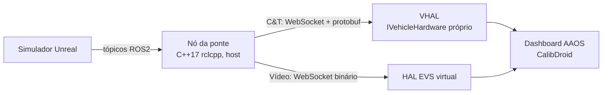

# VIPEE ROS2AAOSBridge

**Versão:** 0.0.0 (pré-MVP; arquitetura decidida, sem código ainda)

Ponte entre um simulador veicular em ROS2 e o Android Automotive (AAOS). Lê tópicos, serviços e ações do ROS2 e os injeta no AAOS: telemetria vira propriedade do **VHAL**, câmeras viram streams do **EVS**. O dashboard do veículo roda acoplado à simulação sem saber que a fonte é simulada, então as funções desenvolvidas no simulador vão para o veículo real trocando só o backend das HALs.

## Arquitetura

* **Host (Linux, ROS2 Humble):** nó `rclcpp` que assina os tópicos do simulador e os traduz por um mapa tabelado e versionado. O ROS2 não roda no Android.
* **Dois canais:** controle e telemetria (WebSocket + protobuf) separados do vídeo (WebSocket binário), para que frames grandes não atrasem os sinais do veículo. O vídeo vai cru (calibração, loopback) ou em JPEG (GbE do RPi5), configurável por câmera.
* **Android:** a ponte vive dentro das HALs. O VHAL usa o `DefaultVehicleHal` do AOSP com um `IVehicleHardware` próprio, e uma HAL EVS virtual entrega as 4 câmeras (`FRONTVIEW`, `REARVIEW`, `LEFTVIEW`, `RIGHTVIEW`). Acima da fronteira HAL, o Android vê um veículo comum.
* **Fail-loud:** sinal ausente ou velho vira `UNAVAILABLE` no VHAL e para o stream no EVS. Nunca há valor padrão ou frame congelado.

As decisões e suas razões estão em [`.specs/STATE.md`](.specs/STATE.md) (AD-001 a AD-010).

## Sinais do MVP

| Sinal | Propriedade VHAL | Uso no dashboard |
| ----- | ---------------- | ---------------- |
| Marcha | `GEAR_SELECTION`, `CURRENT_GEAR` | Câmera de ré exigida por legislação |
| Velocidade | `PERF_VEHICLE_SPEED` | Decisão de solicitar câmera |
| Portas | `DOOR_POS` | Corte do sinal do BEV |
| Retrovisores | `MIRROR_FOLD` | Corte do sinal do BEV |
| 4 câmeras 720p | EVS | Dashboard, AVM e calibração (CalibDroid) |

O que o simulador publica está em [`docs/sim-contract.md`](docs/sim-contract.md) (rascunho v0.1, em negociação com o time do simulador).

## Etapas de validação

1. Emulador AAOS (AOSP `android-16.0.0_r4`).
2. Mula Raspberry Pi 5 com AAOS 16 (`aosp_rpi5_car`, raspberry-vanilla; ver [`Refs/android-auto-RPi5.pdf`](Refs/android-auto-RPi5.pdf)). **Demo para o stakeholder em 2026-11-28.**
3. Veículo de engenharia (Qualcomm SA6155P).

## Dependências

* Ubuntu 22.04, GCC/Clang com C++17, CMake ≥ 3.21, Ninja, vcpkg.
* ROS2 Humble (`/opt/ros/humble`), `ROS_DOMAIN_ID=25`.
* Árvore AOSP 16 em `$ANDROID_BUILD_TOP` e `adb`.
* Python 3.10 e `uv` para ferramentas auxiliares.

O setup completo, as variáveis de ambiente e as armadilhas do ambiente estão no [`AGENTS.md`](AGENTS.md) §6. Os comandos de build entram aqui junto com o primeiro código.

## Projetos irmãos

* [`VIPEE-CalibDroid`](https://github.com/Robsic/VIPEE-CalibDroid): app AAOS de calibração extrínseca; consome as 4 câmeras desta ponte.
* [`VIPEE-SynthCamStream`](https://github.com/Robsic/VIPEE-SynthCamStream): publica o dataset WoodScape como 4 tópicos ROS2; fonte de câmeras para teste.
* [`VIPEE-UndistortDemo`](https://github.com/Robsic/VIPEE-UndistortDemo): runtime AVM, consumidor final das câmeras.

## Contribuindo

Desenvolvimento por especificação (skill `tlc-spec-driven`), testes RED-GREEN-REFACTOR e Conventional Commits. Regras completas no [`AGENTS.md`](AGENTS.md).
